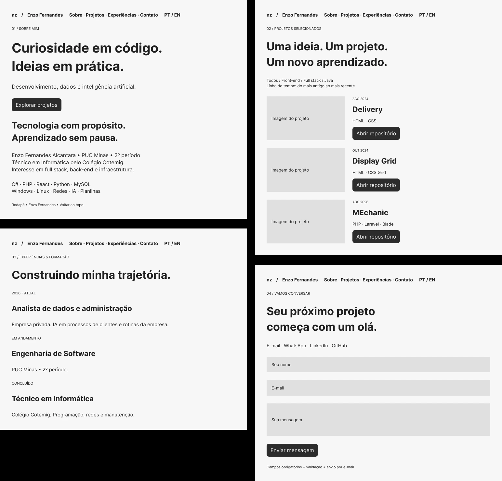
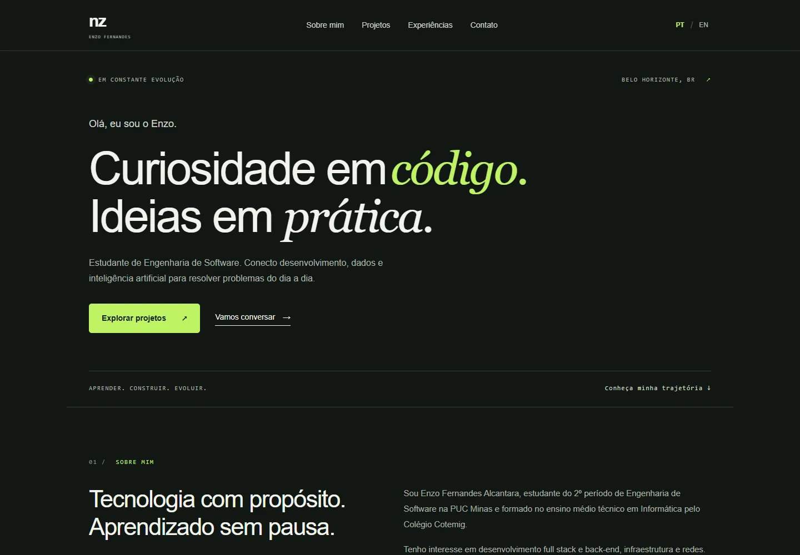

# nz | Portfólio Profissional — Enzo Fernandes Alcantara

Portfólio desenvolvido para o **Laboratório 01 de Desenvolvimento e Integração de Aplicações Web (DIAW)**, do curso de Engenharia de Software da PUC Minas. Professor: João Paulo Carneiro Aramuni.

Apresenta minha formação, experiência com dados e administração, conhecimentos técnicos, projetos e canais de contato em uma interface responsiva, com conteúdo em português e inglês.

## Status e links úteis

- **Prévia local:** `http://localhost:4173`, depois de executar `npm start`.
- **Site publicado no GitHub Pages:** https://enzofernandesnz.github.io/portfolio-nz/ — [informações da entrega](ENTREGA.md).
- **Wireframes editáveis:** [Figma — LAB01](https://www.figma.com/design/NjzgMxO5X7h9xFp9uEPsMC).
- **Perfil do autor:** [GitHub](https://github.com/enzofernandesnz) · [LinkedIn](https://www.linkedin.com/in/enzo-fernandes-dev).
- **Repositório deste portfólio:** [enzofernandesnz/portfolio-nz](https://github.com/enzofernandesnz/portfolio-nz).
- **Formulário:** integração implementada; a primeira utilização exige confirmar o e-mail do FormSubmit. Entrega real de e-mail ainda precisa ser testada pelo destinatário.

## Índice

1. [Sobre o projeto](#sobre-o-projeto)
2. [Funcionalidades](#funcionalidades)
3. [Tecnologias e dependências](#tecnologias-e-dependências)
4. [Arquitetura](#arquitetura)
5. [Instalação e execução](#instalação-e-execução)
6. [Deploy](#deploy)
7. [Estrutura de pastas](#estrutura-de-pastas)
8. [Protótipos e demonstração](#protótipos-e-demonstração)
9. [Projetos e fontes de conteúdo](#projetos-e-fontes-de-conteúdo)
10. [Testes](#testes)

## Sobre o projeto

O site centraliza minha apresentação profissional, meus projetos e os meios de contato. É voltado a recrutadores, professores, colegas e pessoas interessadas em conhecer meu trabalho.

O nome curto escolhido é **nz**. O visual combina fundo verde escuro, tipografia clara, detalhes em verde-lima e uma seção de projetos em fundo claro. A página inicial prioriza texto e não utiliza retrato nem ilustração decorativa.

## Funcionalidades

- Navegação por âncoras: Sobre Mim, Projetos, Experiências e Contato.
- Fumaça interativa SplashCursor em toda a tela, incluindo as margens laterais: responde ao mouse e ao toque, sem bloquear o conteúdo e respeita a preferência por movimento reduzido.
- Conteúdo em português e inglês; preferência de idioma persistida no navegador.
- Linha do tempo gerada a partir de dados JavaScript, em ordem cronológica crescente.
- Filtros por Front-end, Full stack e Java.
- Imagens reais dos projetos disponíveis e ampliação em janela acessível.
- Histórico profissional e formação acadêmica.
- Links de e-mail, WhatsApp, LinkedIn e GitHub.
- Formulário com nome, e-mail e mensagem, validação nativa e envio pelo FormSubmit.
- Menu móvel, foco visível, link para pular ao conteúdo, estrutura semântica e respeito à preferência de movimento reduzido.

## Tecnologias e dependências

| Camada | Tecnologia | Uso |
|---|---|---|
| Front-end | HTML5 | Conteúdo e estrutura semântica |
| Estilos | CSS3, Grid e Flexbox | Layout, identidade visual e responsividade |
| Interatividade | JavaScript ES moderno | Idiomas, filtros, timeline, menu e modal |
| Back-end de contato | FormSubmit, serviço externo | Recebimento do POST, captcha e entrega por e-mail |
| Servidor de desenvolvimento | Node.js 20+ | Servir a pasta `dist` localmente |
| Efeito visual | SplashCursor / React Bits, adaptado para JavaScript nativo | Simulação de fluido em WebGL; código incluído localmente, sem dependências npm |
| APIs nativas | LocalStorage, IntersectionObserver, Dialog, Constraint Validation | Preferências, navegação, modal e validação |
| Protótipos | Figma | Wireframes de média fidelidade, editáveis |
| Hospedagem | GitHub Pages; configuração alternativa para Vercel | Distribuição dos arquivos estáticos |
| Verificação | Playwright e Microsoft Edge | Testes de interface e capturas durante o desenvolvimento |

**Não há banco de dados nem servidor de aplicação próprio em produção.** Os projetos ficam em uma lista no código; o serviço externo implementa o processamento do formulário. Essa escolha reduz a complexidade de manutenção de um portfólio pessoal e atende ao envio de contato previsto na atividade. O Node.js local não envia e-mails.

## Arquitetura

```text
Visitante
  ├── Hospedagem estática → index.html + style.css + app.js + assets
  │                         ├── renderização dos projetos e filtros
  │                         ├── idioma PT/EN e preferência local
  │                         └── navegação e janelas de detalhes
  └── Formulário POST → FormSubmit → caixa de e-mail de Enzo
```

O conteúdo permanece disponível sem uma consulta ao GitHub em tempo real. Assim, limites da API ou indisponibilidade do GitHub não impedem a leitura do portfólio. Os links para os repositórios continuam disponíveis.

### Fumaça interativa (SplashCursor)

O efeito parte do [exemplo ReactBits do professor João Paulo Aramuni](https://github.com/joaopauloaramuni/desenvolvimento-e-integracao-de-aplicacoes-web/tree/main/PROJETOS/React/ReactBits), com o componente SplashCursor de David Haz / React Bits adaptado ao JavaScript nativo do portfólio. O motor de fluido utiliza WebGL; não foi necessário migrar o site para React.

Um único canvas fixo cobre toda a área visível do navegador, incluindo as margens e todas as seções, com `pointer-events: none`. As coordenadas do mouse e do toque são relativas à janela, independentemente da largura dos blocos de conteúdo. A cor verde-lima acompanha a identidade visual. A resolução da simulação e a taxa de atualização são limitadas; a renderização pausa quando a aba fica oculta ou `prefers-reduced-motion` está ativo. Sem suporte WebGL, ou após perda do contexto gráfico, o conteúdo permanece disponível sem animação.

O código e os créditos estão em `dist/splash-cursor.js`, e a licença MIT + Commons Clause acompanha a distribuição em `dist/licenses/LICENSE-react-bits.md`. A adaptação acrescenta cobertura da janela, controle de visibilidade, acessibilidade e liberação de recursos gráficos.

Capturas da primeira versão do efeito (anterior à expansão para toda a tela): [Início](docs/splash-inicio.webp) · [Sobre Mim](docs/splash-sobre.webp).

### Formulário e privacidade

O destinatário está configurado no atributo `action` do formulário em `dist/index.html`. Não há senha nem chave secreta no código. O formulário utiliza captcha do serviço e um campo honeypot. A página informa que nome, e-mail e mensagem são processados pelo FormSubmit.

**Ativação:** abrir o site hospedado, preencher o formulário e enviar uma mensagem de teste; em seguida, confirmar a ativação recebida em `enzofalcantara@gmail.com`. Verificar também a pasta de spam. Depois da confirmação, realizar um segundo envio e conferir o recebimento. A tela não apresenta sucesso simulado: a confirmação é responsabilidade da resposta do serviço.

## Instalação e execução

### Pré-requisitos

- Node.js 20 ou superior.
- Navegador atualizado.
- Internet para abrir links externos e enviar o formulário.

### Como executar

1. Extraia a pasta `portfolio-enzo` do pacote ou clone o repositório depois de publicado.
2. Abra um terminal nessa pasta.
3. Execute:

```sh
npm start
```

4. Acesse `http://localhost:4173`.

Não é necessário executar `npm install`: o servidor utiliza apenas módulos nativos do Node.js. Também é possível abrir `dist/index.html` para inspecionar o layout; para testar o formulário, utilize o site servido por HTTP ou HTTPS.

### Verificação de sintaxe

```sh
npm run check
```

### Personalização

- **Textos e experiência:** `dist/index.html`.
- **Projetos, datas e tecnologias:** lista `projects` no início de `dist/app.js`.
- **Identidade visual:** variáveis de cor e regras em `dist/style.css`.
- **Imagens:** `dist/assets`.
- **Novo idioma:** atributos `data-pt`/`data-en` no HTML e textos dos projetos.

Ao incluir um projeto, preencha nome, data de referência, categoria, tecnologias, descrições nos dois idiomas, link do repositório e imagem real. As datas atuais representam criação dos repositórios; não são datas declaradas de conclusão dos trabalhos.

## Deploy

### Hospedagem desta entrega

A publicação usa a pasta `dist` e o workflow `.github/workflows/pages.yml`. O endereço publicado é https://enzofernandesnz.github.io/portfolio-nz/. Publicação concluída com sucesso em 12/10/2026. Consulte [ENTREGA.md](ENTREGA.md).

### GitHub Pages

1. Acesse o repositório `enzofernandesnz/portfolio-nz`.
2. O código, o README, `docs`, `dist` e `.github` já estão na branch `main`.
3. Em **Settings → Pages → Build and deployment**, selecione **GitHub Actions**.
4. Execute o workflow `Publicar portfolio no GitHub Pages`, ou faça um envio para a branch `main`.
5. Copie o endereço fornecido pelo deploy para a seção de links úteis deste README.

O workflow já está em `.github/workflows/pages.yml`. Os caminhos dos recursos são relativos para funcionar em um subdiretório do GitHub Pages.

### Vercel

1. Importe o repositório do portfólio na sua conta Vercel.
2. Selecione o preset **Other** e o diretório de saída `dist`.
3. Deixe os comandos de instalação e build vazios.
4. Publique e atualize o link deste README com o endereço fornecido.

A configuração está em `vercel.json`. Nenhuma variável de ambiente é necessária para esta versão.

## Estrutura de pastas

```text
portfolio-enzo/
├── .github/workflows/pages.yml   # Publicação no GitHub Pages
├── dist/
│   ├── index.html                # Página com as quatro seções
│   ├── style.css                 # Estilos e regras responsivas
│   ├── app.js                    # Conteúdo dinâmico e interações
│   ├── splash-cursor.js          # Fumaça interativa em toda a janela
│   ├── licenses/                # Licença do componente React Bits
│   └── assets/                   # Imagens reais e ícone nz
├── docs/
│   ├── wireframes.webp            # Visão geral exportada do Figma
│   ├── inicio.webp                # Captura do site
│   ├── desktop.webp               # Página completa em desktop
│   ├── mobile.webp                # Página completa em celular
│   ├── PLANEJAMENTO.md           # Requisitos, sprints e decisões
│   └── APRESENTACAO.md            # Roteiro de demonstração
├── ENTREGA.md                    # Situação e ações finais
├── README.md
├── package.json
├── server.mjs                    # Servidor local sem dependências
└── vercel.json
```

## Protótipos e demonstração

### Wireframes de média fidelidade

[Abrir os protótipos editáveis no Figma](https://www.figma.com/design/NjzgMxO5X7h9xFp9uEPsMC).



Os wireframes organizam hierarquia, navegação, conteúdo e versão móvel. O tratamento monocromático e os espaços reservados para imagens são intencionais nesta etapa. A implementação final aplica as cores escolhidas e amplia a timeline com os demais projetos do autor.

### Site implementado



Capturas completas: [Desktop](docs/desktop.webp) · [Celular](docs/mobile.webp).

## Projetos e fontes de conteúdo

| Data do repositório | Projeto | Tecnologias verificadas | Origem |
|---|---|---|---|
| 13/08/2024 | Delivery | HTML, CSS | [Repositório](https://github.com/enzofernandesnz/delivery) |
| 28/10/2024 | Display Grid | HTML, CSS Grid | [Repositório](https://github.com/enzofernandesnz/Display-grid) |
| 08/08/2025 | Gerenciamento de Pedidos | C#, .NET 8, Blazor Server, Bootstrap | [Repositório](https://github.com/enzofernandesnz/atv6_blazor) |
| 09/04/2026 | Estagi.ON | HTML, CSS, JavaScript, Node.js, JSON Server | [Repositório](https://github.com/ICEI-PUC-Minas-PMGES-TI/pmg-es-2026-1-ti1-0427200-estagi-on) |
| 06/08/2026 | MEchanic | PHP, Laravel, Blade, SQLite | [Repositório](https://github.com/enzofernandesnz/MEchanic-dev) |
| 28/09/2026 | Perfil dos Candidatos — MG | Java, Spring Boot, Thymeleaf, OpenCSV | [Repositório](https://github.com/enzofernandesnz/Projeto-Candidatos-TSE-2) |
| 28/09/2026 | Gestão de Oficina | Java, POO, ArrayList, Scanner | [Repositório](https://github.com/enzofernandesnz/prova1) |

As descrições foram conferidas no código dos repositórios públicos. Estagi.ON e MEchanic são explicitamente apresentados como projetos em equipe. Display Grid é um exercício inspirado no layout Ogani. Repositórios de templates copiados por fork não foram apresentados como projetos próprios.

O Estagi.ON foi desenvolvido em grupo no 1º semestre de 2026. Enzo recebeu o certificado de melhor projeto de **Trabalho Interdisciplinar: Desenvolvimento de Aplicação Web**, conforme seu relato. A imagem do cartão é a [captura de listagem de vagas da documentação da equipe](https://github.com/ICEI-PUC-Minas-PMGES-TI/pmg-es-2026-1-ti1-0427200-estagi-on/blob/master/docs/images/funcionalidades/Listagem_de_vagas.png).

Formação e contatos vêm do currículo fornecido por Enzo. A experiência como analista de dados e administração, o uso de IA e a preferência por manter a empresa anônima foram informados diretamente pelo autor. O período `2026 – atual` evita inventar um dia exato de admissão.

## Testes

Verificações realizadas durante o desenvolvimento:

- Navegação entre as quatro seções e menu móvel.
- Alternância PT/EN e persistência da preferência.
- Filtros e ordem cronológica dos projetos.
- Abertura e fechamento do modal de imagens/detalhes.
- Campos obrigatórios, endereço de e-mail inválido e comprimentos mínimos.
- Layout em larguras de 320, 390, 768 e 1440 pixels.
- Verificação de erros JavaScript no navegador.
- SplashCursor em toda a janela, incluindo margens laterais, mouse e toque, links acessíveis, pausa em aba oculta, movimento reduzido, redimensionamento e fallback sem WebGL.

Os resultados finais e limitações estão em [ENTREGA.md](ENTREGA.md). Teste do recebimento real de e-mail depende da ativação do destinatário; não foi simulado.

## Autor

**Enzo Fernandes Alcantara — nz**  
Engenharia de Software, PUC Minas  
E-mail: enzofalcantara@gmail.com

## Referências e agradecimentos

- Estrutura deste README adaptada ao [template do professor João Paulo Aramuni](https://github.com/joaopauloaramuni/desenvolvimento-e-integracao-de-aplicacoes-web/blob/main/TEMPLATES/template_README.md).
- [React Bits — SplashCursor](https://reactbits.dev/animations/splash-cursor), de David Haz. Licença incluída em `dist/licenses/LICENSE-react-bits.md`.
- [Documentação do FormSubmit](https://formsubmit.co/documentation).
- [Documentação do GitHub Pages](https://docs.github.com/en/pages).
- [Documentação da Vercel](https://vercel.com/docs).
- Os projetos, imagens e bibliotecas de terceiros mantêm suas atribuições e licenças originais.

### Globo de linguagens e tecnologias

Na seção Sobre mim, abaixo do título, o SkillsGlobe apresenta 14 tecnologias do currículo e dos projetos. O exemplo de [João Paulo Aramuni](https://github.com/joaopauloaramuni/desenvolvimento-e-integracao-de-aplicacoes-web/tree/main/PROJETOS/React/SkillsGlobe) foi adaptado para JavaScript nativo, Canvas 2D e CSS, sem dependências adicionais. A geometria distribui os ícones em uma esfera e os projeta com perspectiva.

Permite arrastar com mouse ou toque, abrir a documentação das tecnologias, pausar a rotação e alternar para uma lista. Respeita a preferência de movimento reduzido, pausa fora da tela e durante a navegação por teclado. Sem JavaScript, mantém uma lista de links acessível. Controles disponíveis em português e inglês.

Arquivos: `dist/skills-globe.js`, `dist/skills-globe.css` e `dist/assets/skills/`. Ícones locais do [Devicon](https://github.com/devicons/devicon), com as respectivas marcas preservadas. Licenças MIT incluídas em `dist/licenses/LICENSE-skills-globe.txt` e `dist/licenses/LICENSE-devicon.txt`.
